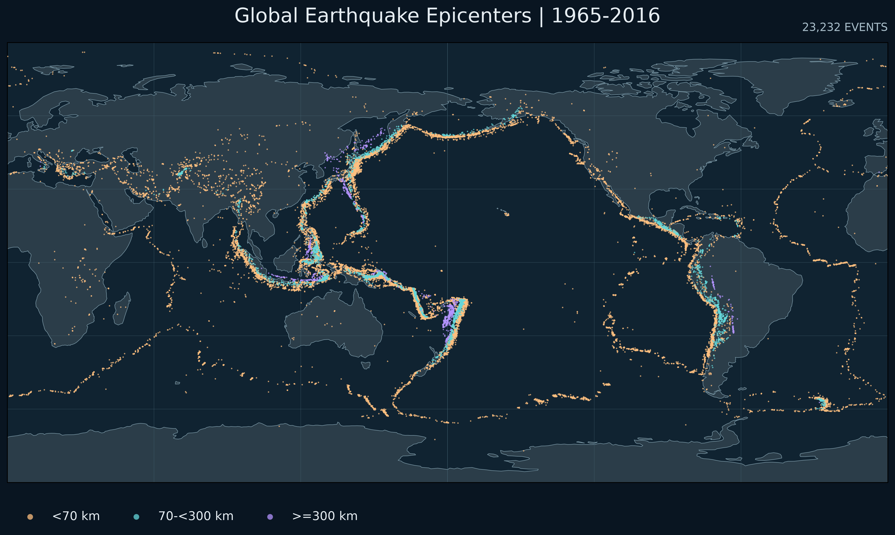

# 地震目录数据处理与可视化

DS 2043 Data Processing Workshop I · 2026 Fall · 选题 07

项目以 1965–2016 年的 USGS 地震目录为输入，完成数据清洗、国家和中国省级区域匹配、海域分类、K-means 聚类及制图。课程 B 部分的 Notebook、扩展目录和提交材料见 [B 部分提交与复现说明](2.country%20match/part-b/B部分_提交说明.md)。

## 目录结构

| 目录 | 内容 |
| --- | --- |
| [`1.datacleaning/`](1.datacleaning/) | 清洗脚本、原始目录 `07earthquake.csv` 和清洗后的 `earthquake_only.csv` |
| [`2.country match/`](2.country%20match/) | 国家、省份和海域匹配脚本，匹配结果 CSV，以及绘图共用的国家和省界文件。B 部分提交材料在 `part-b/` |
| [`3.plot/`](3.plot/) | 全球和中国地图脚本、全球底图数据，以及两套震中分布图和深度分组图 |
| [`4. k_means/`](4.%20k_means/) | K-means 聚类和绘图脚本、聚类结果 CSV、全球聚类分布和年度计数图 |

## 安装与运行

使用 Python 3.13。克隆项目后，在仓库根目录安装依赖。

```bash
git clone https://github.com/pig-xuan/Earthquake_Data_Processing_Workshop_I_Project.git
cd Earthquake_Data_Processing_Workshop_I_Project
python3.13 -m venv .venv
source .venv/bin/activate
python -m pip install -r requirements.txt
```

下面的顺序可以从原始 CSV 重新生成全部结果。脚本使用相对于仓库的输入和输出路径，因此也可以在其他目录用脚本的绝对路径执行。各脚本将结果写入各自所在的阶段目录。阶段之间直接读取上游 CSV 或共用边界文件。

```bash
# 1. Data cleaning
python "1.datacleaning/clean_earthquakes.py"

# 2. Country, province and ocean matching
python "2.country match/match_countries.py"
python "2.country match/match_china_provinces.py"
python "2.country match/match_oceans.py"

# 3. Earthquake maps
python "3.plot/plot_world.py"
python "3.plot/plot_china.py"

# 4. K-means clustering and visualization
python "4. k_means/cluster_earthquakes.py"
python "4. k_means/plot_clusters.py"
```

| 脚本 | 生成文件或用途 |
| --- | --- |
| `clean_earthquakes.py` | `earthquake_only.csv`。加 `--inspect` 可只打印前 19 步清洗检查，不写入 CSV |
| `match_countries.py` | `earthquake_country.csv`，按国家边界匹配 |
| `match_china_provinces.py` | `earthquake_country_province.csv` 和 `earthquake_china_province.csv` |
| `match_oceans.py` | `earthquake_ocean.csv`、`earthquake_ocean_summary.csv` 和 `earthquake_ocean_unresolved.csv`。默认读取全球国家与省级匹配表，也可用 `--input` 指定其他匹配表 |
| `cluster_earthquakes.py` | `earthquake_kmeans.csv`。将经纬度转成单位球面坐标，再用 NumPy 实现的 K-means 分为 6 组 |
| `plot_world.py` | 从清洗表生成全球震中分布图和深度分组图 |
| `plot_china.py` | 从中国省级匹配表生成中国震中分布图和深度分组图 |
| `plot_clusters.py` | 从聚类表生成全球聚类分布和年度计数图 |

主要脚本所需边界数据随仓库提供，依赖装好后可以离线运行。B 部分提交包包含独立的 Notebook 流程和 1965–2024 年扩展目录，使用的海域边界和分类口径见该提交包的说明。

## 数据与检查结果

原始课程 CSV 有 23,412 条记录，涵盖 1965–2016 年，字段为日期、时间、纬度、经度、事件类型、深度（km）和震级。清洗在副本上筛选 `Earthquake` 事件，统一日期时间格式，保留零基原始行号 `source_row`，并给深度和震级添加标记。原始 CSV 及经纬度、深度和震级测量值保持原样。

| 检查项 | 结果 |
| --- | ---: |
| 原始记录 / 地震记录 | 23,412 / 23,232 |
| 非地震事件 | 180 |
| 格式异常的日期 / 时间文本 | 3 / 3 |
| 时间解析失败 / 坐标越界 | 0 / 0 |
| 年度与年月统计合计 | 均为 23,232 |
| 负深度 / 零深度 / M ≥ 7 | 3 / 4 / 738 |
| 匹配到国家或地区 / 未匹配 | 4,781 / 18,451 |

国家和省级匹配按 Natural Earth 多边形的内部进行空间连接。海域分类只处理国家匹配为空的记录，对边界重叠且海洋归属不一致的震中标记 `ambiguous`，并将未得到海洋归属的记录一并保存在待复核表中。地图深度区间为浅源（低于 70 km）、中源（70 至低于 300 km）和深源（至少 300 km）。

## 结果预览



[中国地震深度分组图](3.plot/china_earthquake_depth_panels.png) · [全球 K-means 聚类图](4.%20k_means/earthquake_kmeans_visualization.png) · [海域统计表](2.country%20match/earthquake_ocean_summary.csv)
